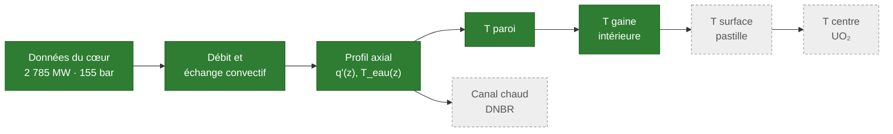
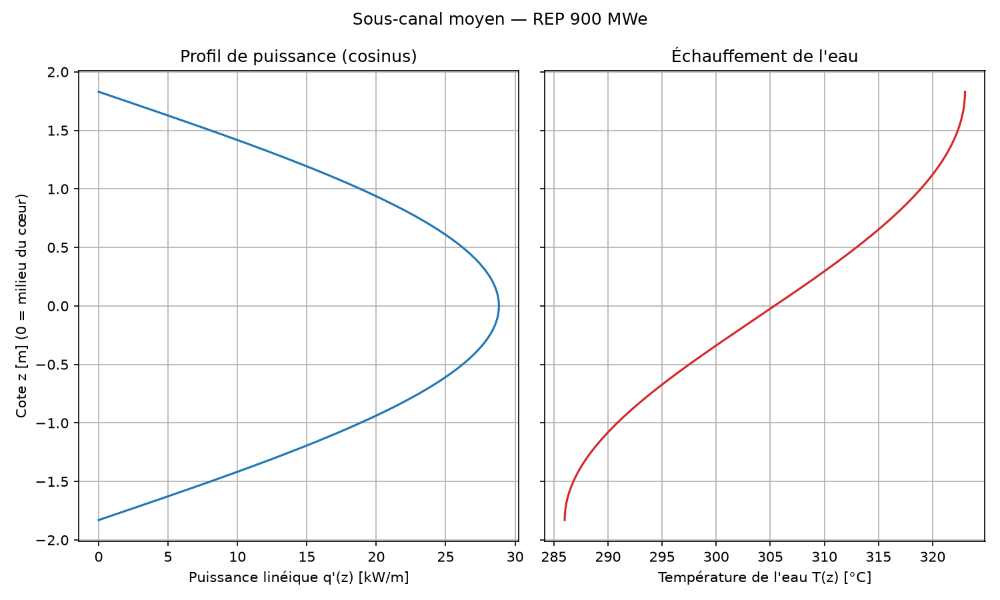

# Modélisation thermo-hydraulique d'un canal chaud de REP

> **Jusqu'où chauffe un crayon de combustible nucléaire, et quelle marge reste-t-il avant la crise d'ébullition ?**
>
> Ce projet répond à cette question pas à pas, en Python, pour un réacteur à eau pressurisée (REP) de 900 MWe :
> on part des données globales du cœur et on remonte le chemin de la chaleur, de l'eau jusqu'au centre de la pastille d'uranium.


-orange)

---

## Sommaire

- [Le problème en une image](#le-problème-en-une-image)
- [Les chiffres clés obtenus](#les-chiffres-clés-obtenus)
- [Démarche](#démarche)
  - [1. Géométrie et débit du sous-canal](#1-géométrie-et-débit-du-sous-canal)
  - [2. Profil axial de puissance et de température](#2-profil-axial-de-puissance-et-de-température)
  - [3. Températures dans l'épaisseur du crayon](#3-températures-dans-lépaisseur-du-crayon)
- [Ce que les résultats racontent](#ce-que-les-résultats-racontent)
- [Hypothèses du modèle](#hypothèses-du-modèle)
- [Feuille de route](#feuille-de-route)
- [Lancer le code](#lancer-le-code)
- [Organisation du dépôt](#organisation-du-dépôt)

---

## Le problème en une image

Un cœur de REP 900 MWe contient **157 assemblages** de **264 crayons** chacun, soit **41 448 crayons** de 3,66 m de haut.
Chaque crayon est un empilement de pastilles d'oxyde d'uranium (UO₂) enfermées dans une gaine en alliage de zirconium.
L'eau du circuit primaire, maintenue liquide à **155 bar**, monte entre les crayons et emporte la chaleur produite par la fission.

On n'étudie pas tout le cœur : on isole **un sous-canal**, le volume d'eau compris entre 4 crayons voisins.
C'est le motif élémentaire du réseau, et il correspond exactement à un crayon.

```
        Vue de dessus du réseau                Coupe d'un crayon (de l'extérieur vers le centre)

     ●─────────●─────────●                     eau (286 → 323 °C)
     │░░░░░░░░░│         │                       │  convection
     │░░░░░░░░░│         │                       ▼
     ●─────────●─────────●                     gaine en Zircaloy (0,57 mm)
     │         │         │                       │  conduction
     │         │         │                       ▼
     ●─────────●─────────●                     jeu rempli d'hélium
                                                 │  conduction + rayonnement
  ● crayon Ø 9,5 mm   pas = 12,6 mm              ▼
  ░ un sous-canal                              pastille UO₂ (Ø 8,19 mm) : la chaleur naît ici
```

**Le fil conducteur :** la seule température imposée est celle de l'eau à l'entrée du cœur (286 °C).
On suit donc la chaleur **à l'envers**, couche par couche, de l'eau vers le combustible :



<sub>En vert : déjà calculé. En gris : à venir.</sub>

---

## Les chiffres clés obtenus

| Grandeur | Valeur | Ce que ça veut dire |
|---|---|---|
| Débit d'eau dans le cœur | **13 381 kg/s** (≈ 48 000 t/h) | ≈ 19 m³ d'eau par seconde : une piscine olympique en un peu plus de 2 minutes |
| Vitesse de l'eau entre les crayons | **5,1 m/s** | Environ 18 km/h, dans un canal de 12 mm |
| Nombre de Reynolds | **5·10⁵** | Écoulement très turbulent : l'eau est fortement brassée |
| Coefficient d'échange gaine → eau | **37 kW/m²/K** | Des centaines à des milliers de fois plus que l'air (10-100 W/m²/K) |
| Puissance linéique moyenne / max | **18,4 / 28,8 kW/m** | Un mètre de crayon dégage autant que 12 à 19 radiateurs électriques de 1,5 kW |
| Température max de la paroi de la gaine | **336,5 °C** à z = +0,67 m | Sous la saturation (344,8 °C) : pas d'ébullition sur le crayon moyen |
| Température max à l'intérieur de la gaine | **370,4 °C** à z = +0,30 m | 37 K de plus à travers seulement 0,57 mm de métal |

> **Contrôle de cohérence :** le profil de température calculé retombe exactement sur **286,0 °C** en bas et **323,0 °C** en haut du cœur.
> Le bilan d'énergie est donc juste de bout en bout.

---

## Démarche

### 1. Géométrie et débit du sous-canal

📄 [`src/geometrie.py`](src/geometrie.py)

| Grandeur | Formule | Résultat |
|---|---|---|
| Section de passage | $A = p^2 - \dfrac{\pi D^2}{4}$ | 87,9 mm² |
| Diamètre hydraulique | $D_h = \dfrac{4A}{\pi D}$ | 11,78 mm |
| Puissance linéique moyenne | $q'_{moy} = \dfrac{P_{th}}{N_{crayons}\, H}$ | 18,4 kW/m |
| Débit du cœur (bilan d'énergie) | $\dot m = \dfrac{P_{th}}{h_{sortie} - h_{entree}}$ | 13 381 kg/s |
| Débit par sous-canal | $\dot m_{sc} = \dot m / N_{crayons}$ | 0,323 kg/s |
| Reynolds | $Re = \dfrac{\rho v D_h}{\mu}$ | 5,0·10⁵ |
| Nusselt (Dittus-Boelter) | $Nu = 0{,}023\, Re^{0,8}\, Pr^{0,4}$ | 786 |
| Coefficient d'échange | $h_{conv} = \dfrac{Nu\, k}{D_h}$ | 37,2 kW/m²/K |

**Pourquoi l'enthalpie plutôt que $c_p \Delta T$ ?** À 155 bar et près de 300 °C, la capacité thermique de l'eau varie fortement quand on s'approche de la saturation.
Les enthalpies données par [CoolProp](http://www.coolprop.org/) en tiennent compte exactement, sans avoir à choisir un $c_p$ moyen.

### 2. Profil axial de puissance et de température

📄 [`src/profil_axial.py`](src/profil_axial.py)

Les neutrons s'échappent par le haut et le bas du cœur : la puissance est donc maximale au milieu.
Pour un cœur homogène, la théorie de la diffusion donne un profil en **cosinus** (z = 0 au milieu du cœur) :

$$
q'(z) = q'_{max} \cos\left(\frac{\pi z}{H}\right), \qquad q'_{max} = \frac{\pi}{2}\, q'_{moy}
$$

Le facteur $\pi/2$ vient du fait que la moyenne d'un cosinus sur une demi-période vaut $2/\pi$ de son maximum.

Un bilan d'énergie sur une tranche d'épaisseur $dz$ ($\dot m_{sc}\, dh = q'(z)\, dz$), intégré depuis le bas du cœur, donne l'enthalpie de l'eau,
que CoolProp convertit ensuite en température :

$$
h(z) = h_{entree} + \frac{q'_{max}\, H}{\pi\, \dot m_{sc}} \left[\sin\left(\frac{\pi z}{H}\right) + 1\right]
$$



**Lecture :** la température de l'eau trace une courbe en **S**. Elle monte vite au milieu, où la puissance est forte, et presque plus aux extrémités, où le flux est quasi nul.

> 🔎 **Un détail qui ne trompe pas :** au milieu du cœur, l'eau est à **305,4 °C**, et non à la moyenne arithmétique 304,5 °C.
> À mi-hauteur, l'eau a reçu la moitié de la puissance : c'est son **enthalpie** qui vaut la moyenne, pas sa température.
> Comme $c_p$ augmente avec T, la seconde moitié de l'énergie fait moins monter la température que la première.

### 3. Températures dans l'épaisseur du crayon

📄 [`src/radial.py`](src/radial.py) · *en cours*

À chaque cote $z$, on ajoute l'écart de température nécessaire pour faire traverser la puissance $q'(z)$ à chaque couche :

```
T_eau ──(+ΔT convection)──► T_paroi ──(+ΔT gaine)──► T_gaine_int ──(+ΔT jeu)──► T_surface_UO₂ ──(+ΔT pastille)──► T_centre
                ✅                          ✅                         à venir                         à venir
```

| Étape | Modèle | Résultat (maximum) |
|---|---|---|
| Convection eau → gaine | Loi de Newton $\Delta T = \dfrac{q'}{h_{conv}\, \pi D}$, avec $h_{conv}(z)$ recalculé en chaque point à partir des propriétés locales de l'eau | $h_{conv}$ de 36 à 39 kW/m²/K · $\Delta T$ = 26 K · **T_paroi = 336,5 °C** |
| Conduction dans la gaine | Cylindre creux : $\Delta T = \dfrac{q'}{2\pi k}\ln\dfrac{r_{ext}}{r_{int}}$ ($k$ = 16 W/m/K) | $\Delta T$ = 36,7 K · **T_gaine_int = 370,4 °C** |

**D'où vient le logarithme ?** Dans un cylindre, la même puissance traverse des surfaces de plus en plus grandes ($2\pi r$ par mètre) quand le rayon augmente.
Le gradient de température est donc plus fort côté intérieur, et l'intégration de $1/r$ fait apparaître un $\ln$.

---

## Ce que les résultats racontent

Le résultat le plus intéressant à ce stade n'est pas une valeur, mais **l'endroit où se trouve le point le plus chaud.**

- **L'eau** est la plus chaude **en haut** du cœur (elle a tout reçu).
- **Le flux de chaleur** est le plus fort **au milieu**.
- Chaque température du crayon additionne les deux effets : $T = T_{eau}(z) + \Delta T(q'(z))$.

Son maximum se trouve donc **entre le milieu et le haut**, et il **descend vers le milieu** à mesure qu'on s'enfonce dans le crayon,
car les écarts proportionnels à $q'$ prennent de plus en plus de poids face à la température de l'eau :

| Température | Position du maximum |
|---|---|
| Eau | z = +1,83 m (sortie du cœur) |
| Paroi de la gaine | z = +0,67 m |
| Face intérieure de la gaine | z = +0,30 m |
| Centre de la pastille | attendu très proche de z = 0 |

C'est exactement pourquoi l'analyse de sûreté ne peut pas se contenter de regarder « le haut » ou « le milieu » du cœur :
chaque critère (température du combustible, marge à l'ébullition) a son propre point critique.

---

## Hypothèses du modèle

Un modèle n'a de valeur que si l'on sait ce qu'il néglige.

| Hypothèse | Justification | Limite / amélioration possible |
|---|---|---|
| Crayon et sous-canal **moyens** | Première étape, avant le canal chaud | Facteurs de point chaud $F_{\Delta H}$, $F_q$ (feuille de route) |
| Sous-canal **isolé**, sans échange avec ses voisins | Simple, et conservatif pour le canal chaud | Mélange turbulent entre sous-canaux (codes COBRA, FLICA) |
| Profil de puissance en **cosinus** symétrique | Solution théorique du cœur homogène | Profil réel aplati et déformé par les barres de commande et l'usure du combustible |
| Corrélation de **Dittus-Boelter** | Classique en convection forcée turbulente, $Re > 10^4$ | Établie pour des tubes ronds ; corrections existantes pour les faisceaux de crayons (Weisman) |
| **Pression constante** (pas de pertes de charge) | $\Delta P_{cœur}$ ≈ 1-2 bar, négligeable devant 155 bar | Effet très faible sur les propriétés de l'eau |
| Conductivité de la gaine **constante** | Varie peu entre 330 et 370 °C | Corrélation $k(T)$ du Zircaloy |
| **Pas de conduction axiale** dans le crayon | Crayon très élancé (3,66 m pour 9,5 mm) : gradients radiaux ≫ axiaux | — |
| **Régime permanent** | Fonctionnement nominal | Simulation de transitoires (feuille de route) |

---

## Feuille de route

- [x] **Séance 1** : géométrie du sous-canal, débit par bilan d'énergie, Reynolds, coefficient d'échange
- [x] **Séance 2** : profil axial de puissance en cosinus et échauffement de l'eau, figure
- [ ] **Séance 3** : températures radiales jusqu'au centre du combustible
  - [x] convection eau → paroi de la gaine
  - [x] conduction dans la gaine
  - [ ] jeu pastille-gaine rempli d'hélium
  - [ ] conduction dans la pastille d'UO₂ avec source de chaleur interne → **température au centre**
- [ ] **Séance 4** : canal chaud et sûreté
  - [ ] facteurs de point chaud ($F_{\Delta H}$, $F_q$)
  - [ ] vérification de l'absence d'ébullition sur le canal le plus chargé
  - [ ] flux critique et **DNBR minimal** (marge à la crise d'ébullition)
- [ ] **Séance 5** : synthèse, figures finales, documentation
- [ ] **Pour aller plus loin** : couplage à une cinétique ponctuelle pour simuler des transitoires, comparaison avec un calcul CFD (code_saturne)

---

## Lancer le code

**Prérequis :** Python 3.10 ou plus récent.

```bash
pip install -r requirements.txt
```

Les scripts s'importent les uns les autres : ils se lancent **depuis le dossier `src/`**.

```bash
cd src
python geometrie.py      # séance 1 : débits, Reynolds, coefficient d'échange
python profil_axial.py   # séance 2 : profils q'(z) et T_eau(z), enregistre figures/profil_axial.png
python radial.py         # séance 3 : températures de paroi et de gaine
```

Exemple de sortie de `radial.py` :

```
h_conv min/max = 36.0 / 39.0 kW/m²/K
ΔT_conv max    = 26.0 K
T_paroi max    = 336.5 °C à z = 0.67 m
ΔT_gaine max   = 36.7 K
T_gaine_int max = 370.4 °C à z = 0.30 m
```

---

## Organisation du dépôt

```
.
├── src/
│   ├── parametres.py     # toutes les données d'entrée du REP 900 MWe, en unités SI
│   ├── geometrie.py      # sous-canal, débits, Reynolds, Dittus-Boelter
│   ├── profil_axial.py   # q'(z) en cosinus, T_eau(z) par bilan d'enthalpie
│   └── radial.py         # températures de paroi et de gaine le long du crayon
├── figures/
│   └── profil_axial.png
├── requirements.txt      # bibliothèques à installer (numpy, matplotlib, CoolProp)
└── README.md
```

**Quelques choix de conception :**

- **Une seule source de données.** Toutes les valeurs d'entrée sont dans `parametres.py`. Aucun chiffre n'est écrit en dur ailleurs : si une donnée change, elle change partout.
- **Unités SI dans tous les calculs.** Les conversions (°C, kW/m, mm) n'ont lieu qu'à l'affichage, ce qui évite les erreurs de facteur 1 000.
- **Un fichier par étape physique.** Chaque fichier importe les résultats du précédent (`from profil_axial import z, q, h, T`), au lieu de recopier des valeurs.
- **Propriétés de l'eau par CoolProp** plutôt que des valeurs de tables recopiées : elles restent précises et cohérentes à 155 bar, quelle que soit la température.

---

<sub>Projet réalisé dans le cadre de mes études à l'ESIEE. Les données sont des ordres de grandeur publics d'un REP 900 MWe et ne représentent pas une installation particulière.</sub>
